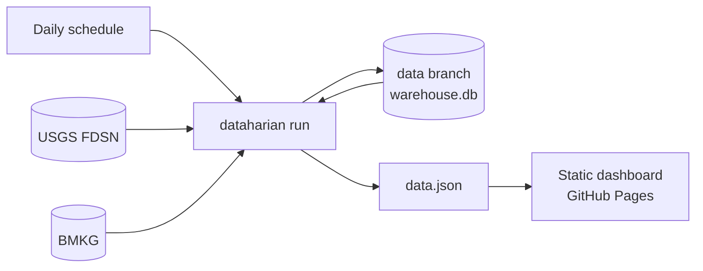

# Gempa Harian

A small data pipeline and a public dashboard for earthquakes in Indonesia. Every day it reads two independent agencies, checks what it got, stores it, compares the two sources against each other and publishes the result. The page shows the data and also shows how far the data can be trusted.

[](https://github.com/indraaryaLabs/pipeline-dataharian/actions/workflows/ci.yml)
[](https://github.com/indraaryaLabs/pipeline-dataharian/actions/workflows/pipeline.yml)

**Live page: https://indraaryalabs.github.io/pipeline-dataharian/**

## What it does

- **Ingests** magnitude 4+ earthquakes from the USGS catalogue and the recent magnitude 5+ list from Indonesia's BMKG, once a day, for free, on GitHub Actions.
- **Validates** every row. A row that is out of range, outside the region or from the future is rejected with a named reason and kept in a table, not silently dropped.
- **Stores** one year in a SQLite warehouse with idempotent upserts. Running the pipeline twice changes nothing; a revised magnitude is updated, not duplicated.
- **Reconciles** the two agencies: a BMKG report and a USGS event are the same earthquake when they are within 90 seconds and 150 km, matched one-to-one, closest first.
- **Checks itself** with nine data-quality checks that run after every load and are published with the data.
- **Publishes** one versioned JSON document that the dashboard reads. The same document has a JSON Schema and a test that validates it.

The dashboard is built around a seismograph drum: one row per day, one tick per earthquake, taller for stronger, coloured by depth. Next to it a map, the strongest events, daily activity, the magnitude-frequency relation with a b-value, the agreement between the two agencies and the health of the pipeline. English and Indonesian, light and dark.

<!-- screenshots -->

## How it fits together



The warehouse lives on a `data` branch that always holds exactly one commit, force-pushed after each run. There is no server and no database service. See [architecture](docs/architecture.md) for the run lifecycle and failure handling.

## Decisions worth a look

| Question                                     | Decision                                                                                                   | Record                                                      |
| -------------------------------------------- | ---------------------------------------------------------------------------------------------------------- | ----------------------------------------------------------- |
| Why two sources?                             | Neither is the truth. Comparing them is more useful than picking one, and it exposes problems in either.   | [ADR 0002](docs/adr/0002-two-agencies-compared.md)          |
| Where does state live for free?              | A SQLite file on a single-commit orphan branch.                                                            | [ADR 0001](docs/adr/0001-sqlite-on-a-data-branch.md)        |
| What if an upstream returns nothing or junk? | A full refresh never deletes more than 20% of stored events and never accepts an empty answer.             | [ADR 0003](docs/adr/0003-refuse-implausible-refreshes.md)   |
| How is "the same earthquake" decided?        | Time and distance windows, one-to-one, closest first. Young BMKG reports count as pending, not as missing. | [ADR 0004](docs/adr/0004-matching-rules.md)                 |
| How does the page stay honest on a bad day?  | The pipeline always exports. The page shows stale, partial and failed runs instead of hiding them.         | [ADR 0005](docs/adr/0005-static-page-reads-one-document.md) |

## Data quality

Nine checks, each `pass`, `warn`, `fail` or `skip`, with thresholds written down in [data-quality](docs/data-quality.md): catalogue present, plausible values, inside the region, fresh, normal daily volume, no double counting, last run clean, reject rate, and agency agreement. The command exits non-zero when a run fails or a check fails, so a bad day turns the workflow red.

## Run it yourself

Python 3.12 or newer, and Node 22.18 or newer for the dashboard.

```bash
make setup                 # virtual environment and dependencies
. .venv/bin/activate
make run                   # reads USGS and BMKG into data/warehouse.db, writes out/data.json
make test lint             # tests with a 95% branch-coverage gate, ruff, mypy --strict

cd dashboard
npm ci
cp ../out/data.json public/data.json
npm run dev                # http://localhost:5175
npm run verify             # typecheck, lint, formatting, unit tests
npm run test:e2e           # browser tests and WCAG 2.2 AA checks (Playwright)
```

No network is needed for development: `dataharian demo` runs the real pipeline against a synthetic upstream and writes fixture data, and the dashboard tests use those fixtures. A test fails if the committed fixtures drift from the code; `make fixtures` regenerates them.

## Layout

```
src/dataharian/   pipeline package: sources, validation, store, reconcile, quality, export
tests/            pipeline tests, including schema validation of the public document
schema/           JSON Schema of the public document
dashboard/        static page: TypeScript, Vite, no framework
docs/             architecture, data contract, data quality, ADRs, runbooks
.github/          CI, the daily pipeline, Pages deployment, Dependabot
```

## Limits you should know about

- USGS lists events of magnitude 4 and above in this region, but the catalogue is only complete down to about 4.5. The b-value uses 4.5 and above for that reason, and needs at least 50 events.
- Magnitudes are revised for days. A fresh number can change.
- BMKG publishes a short list of recent magnitude 5+ events, so the comparison covers only those and only events old enough to appear in both.
- Locations are the nearest town in the USGS description, not an administrative area.
- This is an independent project, not an official warning service. For warnings, use BMKG.
- GitHub disables scheduled workflows after 60 days without repository activity; the [runbook](docs/runbooks/pipeline-failed.md) says how to recognise and fix that.

## Data and licence

Earthquake data comes from the [USGS Earthquake Catalog](https://earthquake.usgs.gov/fdsnws/event/1/) (public domain) and [BMKG](https://data.bmkg.go.id/) open data. Basemap from [Natural Earth](https://www.naturalearthdata.com/) (public domain) through the `world-atlas` package. Code is MIT, see [LICENSE](LICENSE).

Built by [Indra Arya](https://github.com/indraaryaLabs).
