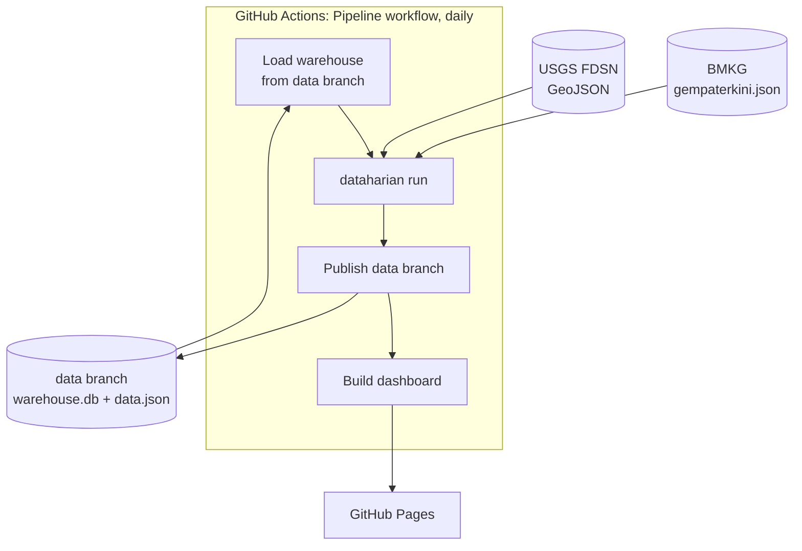

# Architecture

One Python package, one SQLite file, one JSON document, one static page. Everything runs on GitHub Actions and GitHub Pages, so there is nothing to host or pay for.

## Components

| Part      | Where                       | Job                                                                            |
| --------- | --------------------------- | ------------------------------------------------------------------------------ |
| Sources   | `src/dataharian/sources/`   | Fetch with retries, parse rows, name what could not be parsed                  |
| Validate  | `validate.py`               | Reject a row with a reason: coordinates, region, magnitude, depth, future time |
| Store     | `store.py`                  | SQLite with a versioned schema; transactional upserts; retention; run history  |
| Reconcile | `reconcile.py`              | Match BMKG reports to USGS events                                              |
| Quality   | `quality.py`                | Nine checks, published with the data                                           |
| Aggregate | `aggregate.py`, `export.py` | Build the public document, deterministically                                   |
| Pipeline  | `pipeline.py`               | One run: fetch, validate, load, reconcile, check, with the safety guards       |
| Dashboard | `dashboard/`                | Static page that reads `data.json` and nothing else                            |

## One run

1. **Mode.** `auto` becomes `backfill` when there is no USGS data or no complete run yet, otherwise `incremental`.
2. **Fetch USGS.** Backfill reads the whole 365-day window in 60-day chunks. Incremental asks only for events updated since the previous complete run, minus a 6 hour overlap, so revisions are picked up.
3. **Fetch BMKG.** The 15 most recent magnitude 5+ events.
4. **Validate.** Rejected rows go to the `rejects` table with a reason.
5. **Load.** Upserts in one transaction. A backfill also removes events that vanished upstream, but refuses when the answer is empty or would delete more than 20% of what is stored.
6. **Reconcile and check.** Rebuild the matches, then run the nine checks.
7. **Export.** Always write `data.json`, even when the run failed, so the page can say what happened.
8. **Status.** `ok` when both sources were read, `partial` when BMKG failed, `failed` when USGS failed. The command exits 1 on `failed` or on a failing check.

## State

The warehouse is a SQLite file. Tables: `quakes`, `runs`, `rejects`, `matches`; the schema version is in `PRAGMA user_version` and migrations run on open. The file is carried between runs on the `data` branch, which is re-created with a single commit each time ([ADR 0001](adr/0001-sqlite-on-a-data-branch.md)).

## Failure behaviour

| What goes wrong                       | What happens                                                                                         |
| ------------------------------------- | ---------------------------------------------------------------------------------------------------- |
| USGS is down or answers 5xx           | Retried with backoff. Run is `failed`; stored data is untouched; page shows older data with a notice |
| BMKG is down                          | Run is `partial`; earthquakes stay current; the agency comparison is marked as not current           |
| A source returns junk rows            | Rows are rejected with reasons and counted. A high reject rate warns, then fails the check           |
| A backfill would wipe the catalogue   | Refused with a clear error; nothing is deleted                                                       |
| The workflow crashes before exporting | Nothing is published; the job fails; the page keeps the last good deployment                         |
| The schedule does not fire            | The page turns "stale" after 36 hours and says so                                                    |
| Two runs overlap                      | Prevented by a concurrency group that queues instead of cancelling                                   |

## The public document

See [data-contract](data-contract.md). The page depends on that one file, so the pipeline and the page can change independently as long as `schemaVersion` holds.

## Dashboard

TypeScript and Vite, no UI framework: small DOM and SVG helpers, one plain state object, and a render that rebuilds the sections while keeping focus, scroll position and open panels. The map is a pre-built projection of Natural Earth 50m (about 42 KB), so there are no tile servers or map libraries. Fonts are bundled, so the page makes no third-party requests. The JavaScript is about 37 KB gzipped, plus the data file.
